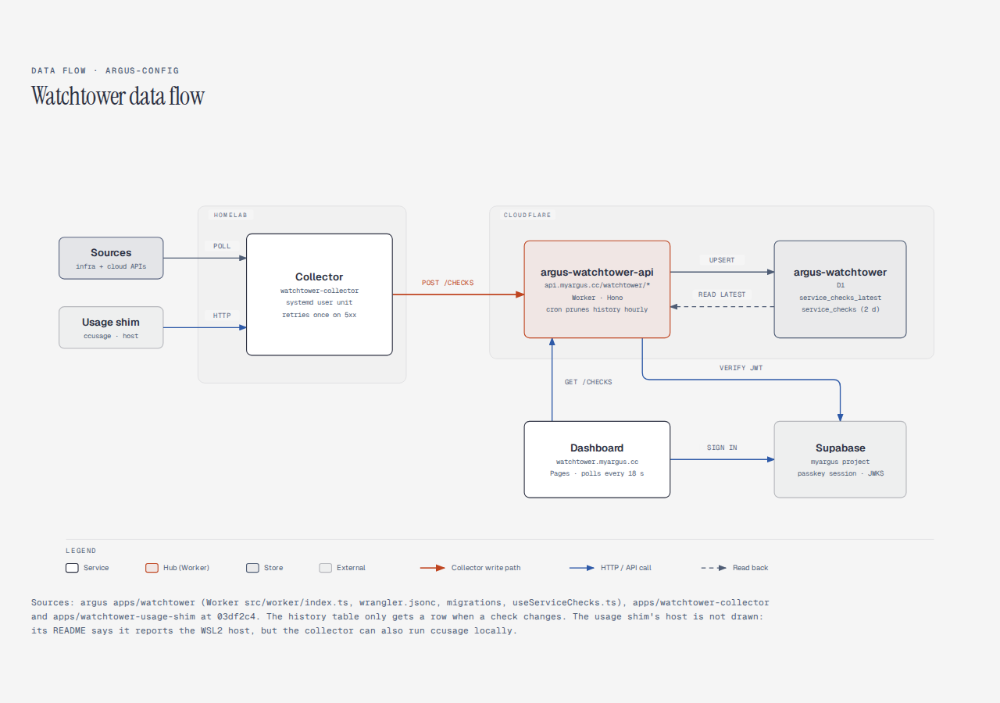

# Watchtower data flow

Self-contained HTML/SVG, drawn with the [diagram-design](https://github.com/cathrynlavery/diagram-design) Claude Code plugin (v2.6.119, default skin). Open [`watchtower-data-flow.html`](watchtower-data-flow.html) in a browser; the PNG is a Playwright screenshot of it. Moved here from `argus-config/docs/diagrams/` (argus-config#961, first added in argus-config#816).

Sources, checked by hand at `03df2c4`: `apps/watchtower` (Worker, `wrangler.jsonc`, migrations, dashboard hook), `apps/watchtower-collector`, `apps/watchtower-usage-shim`.

## Not drawn

- The collector's individual adapters.
- Which host runs the usage shim (its README says WSL2, but the collector can also run ccusage locally).

## Network

The HTML loads Google Fonts (`fonts.googleapis.com`, `fonts.gstatic.com`) and makes no other request. The plugin's `system` font source removes it.

## Redrawing

After the sources change, redraw with the plugin and rerun its checks: `self_check.py` in the skill directory and `verify-geometry.py` in the plugin's `scripts/`.
